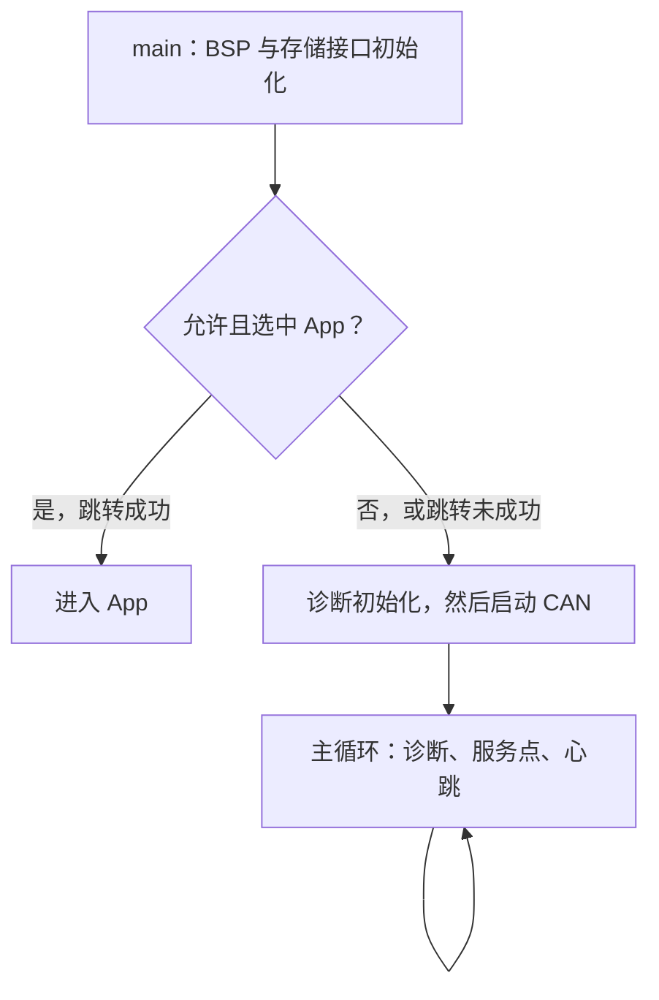

# 把 CAN/UDS 固件更新工程读懂：源码学习路线

适用版本：v0.12。工程目录：`D:\Project\Can\ota-core`。

目标是你能自己画流程、找到代码、预测异常结果，并完成一处小改动和验证。你已有 C、STM32、CAN 基础，本轮直接围绕项目学习。第一轮优先读本项目 C 主干和对应测试，再进入硬件驱动、上位机及构建细节。

建议每个学习单元用 60～90 分钟，有余力再加半小时实验。第一轮 14 个单元，按每天一课约 2～3 周；第二轮再用约一周起步做四个强化专题。完成标准看实际理解，遇到卡点可拆成两次，不用赶日历。

本计划包含“完整升级架构”的源码阅读。当前四套探索者固件仍是只读入口，写入、跳转和看门狗门控关闭；主机仿真通过不代表板上已经实现全部流程。签名校验尚未实现，当前 MCU 主循环尚未使用 FreeRTOS。

## 一、每天怎么读

每次只抓一个目标，例如“为什么安装到一半断电后还能重做”。按这个顺序：

1. **先预测，10 分钟**：不看代码，写下正常情况和一种失败情况会怎样。
2. **看接口，15 分钟**：读相关 `.h`，列出结构体、输入、返回值和状态字段。
3. **追主路径，30 分钟**：只跟今天的问题，从调用者进入关键函数，再回到调用者。遇到 HAL 先弄清参数、完成条件和错误返回，随后回到主线。
4. **对照验证，15～20 分钟**：读一条对应测试，预测断言，再运行已有台架或在练习副本中做小实验。
5. **口述，5 分钟**：关掉代码，用自己的话说出“数据放哪、状态怎么变、失败怎么办”。

看每个关键函数时，固定回答五个问题：

- 谁调用它，传入的上下文对象是什么？
- 它读取/修改哪些变量，哪些变化会写入非易失存储？
- 成功与失败的返回值分别是什么？
- 调用者收到失败后做什么？
- 此时复位，下一次启动靠什么判断状态？

能指到实现和测试、能解释一种失败路径、能预测一次状态变化，才算这一课通过。暂时需要看解释才能复述，就把它标为“还需复习”，不用假装已经会了。

## 二、第一轮：14 个主线单元

表里的函数名和阅读位置已按当前 v0.12 源码核对。行号仅供当前版本定位，后续改动后以函数名查找。

| 单元 | 今天解决的问题 | 优先阅读 | 当天产出与通过标准 |
|---|---|---|---|
| 1. 工程地图 | 新包、旧包、App、元数据分别在哪里？上电后谁组织工作？ | [flash_layout.h](../include/ota/flash_layout.h)、[metadata.h](../include/ota/metadata.h)、[Bootloader main](../firmware/bootloader/main.c) 的 `main` | 画出三种存储器的分区；找到初始化、诊断循环和被宏关闭的跳转分支 |
| 2. 接口与台架 | 同一份 C 核心为什么既能在 PC 测试，又能接 STM32？ | [ota_port.h](../include/ota/ota_port.h)、[RAM Flash](../src/port/host/flash_ram.c)、[bench.h](../tests/bench.h)、[测试入口](../tests/test_main.c) | 能追一次 `port.read(port.user, ...)`，说清函数指针和 `user` 各自作用；运行 C 检查并解释其证据范围 |
| 3. 镜像与 CRC | 下载包如何变成可检查的镜像？为什么包头不能直接放到 App 向量表前？ | [image.h](../include/ota/image.h)、[image.c](../src/core/image.c) 的 `image_header_ok` / `validate_payload`、[crc32.c](../src/core/crc32.c)、[CRC 测试](../tests/test_crc.c) | 画出“32 字节头 + payload”；区分头 CRC、payload CRC、向量边界检查与签名 |
| 4. 读元数据 | 两份记录如何选出最新有效的一份？ | [metadata.c](../src/core/metadata.c) 的 `read_copy`、`metadata_load_ex`；[启动测试](../tests/test_boot.c) 的 `metadata_faults` | 分析 A/B 都有效、只有一份有效、相同序号但内容冲突、读取失败四种情况；正确解释 1/0/-1 |
| 5. 写元数据 | 写到一半断电，为什么旧记录还有机会保留？ | 同一文件的 `write_bytes`、`metadata_save`；启动测试中的 `metadata_faults` | 画出“选择另一份 → 使目标 commit 无效并读回 → 写 body/CRC → 最后写 commit → 整体读回”；标三个断电点 |
| 6. 备份与安装 | 什么时候可以开始擦内部 App？重启后为什么能重做安装？ | [boot.c](../src/core/boot.c) 的 `create_backup`、`install`、`boot_select` 中 READY/INSTALLING 分支；启动测试的 `fixtures` / `ordinary_paths` | 画出备份验证、持久化 INSTALLING、擦写 App 的先后顺序；解释只搬 payload 和末尾 4 字节对齐 |
| 7. 试运行与回滚 | 新 App 有 CRC 就能正式提交吗？连续启动未确认会怎样？ | `boot_select` 的 TRIAL/RESTORING 分支、`boot_confirm`、`boot_accept_app_health`；[App main](../firmware/app/main.c) | 手推三次新 App 试运行及之后的恢复；解释谁确认健康，以及首次安装没有旧版本时的结果 |
| 8. UDS 下载主线 | 0x34、0x36、0x37、0x31 分别完成哪一步？ | [uds.c](../src/core/uds.c) 第 282～405 行的四个处理函数；[uds.h](../include/ota/uds.h) | 用“请求 → 条件检查 → 存储动作 → 状态 → 应答”写出一遍；指出 0x37 完成后是 READY |
| 9. UDS 异常与状态 | 重复块、错误块号、长度不符、会话超时如何处理？ | `handle_transfer_data`、`uds_poll`、`append_did`；启动测试的 `ordinary_paths`；[状态格式](UPDATE_STATUS.md) | 解释相同重复块为什么不能重复累计长度，内容变了为什么拒绝；用状态 DID 区分“下载好”和“安装好” |
| 10. ISO-TP 主线 | 一条较长 UDS 消息如何经过多帧 CAN？ | [isotp.h](../include/ota/isotp.h)、[isotp.c](../src/core/isotp.c) 的 `isotp_send`、`isotp_on_frame`、`isotp_read`；[ISO-TP 测试](../tests/test_isotp.c) 的 `roundtrip` | 手拆 SF/FF/CF/FC；指出首个 CF 的 SN 是 1，并区分它和 UDS 的 BSC |
| 11. 流控与超时 | BS、STmin、WAIT、丢帧和计时器回绕影响什么？ | `isotp_poll`；ISO-TP 测试的 `stmin_test` / `drop_fc_test` / `rx_timeout_test`；[协议边界测试](../tests/test_protocol_edges.c) 的 `flow_checks` / `timer_checks` | 预测丢 FC、收错 SN、只收到半包时的行为；解释无符号时间差比较 |
| 12. 中断到诊断 | 一帧 CAN 怎样从中断走到 `uds_handle`？ | [参考中断](../platform/stm32f407/board/explorer_reference/explorer_interrupts.c)、[HAL 绑定](../platform/stm32f407/examples/board_hal_binding.c)、[CAN 队列](../platform/stm32f407/src/stm32_can.c)、[诊断轮询](../platform/stm32f407/src/stm32_diag.c) | 画出“IRQ → HAL 回调 → 入队 → 主循环 → ISO-TP → UDS”；找到编程门控和队列满处理 |
| 13. 从 Bootloader 到 App | 返回启动目标和真正跳转有什么区别？ | [stm32_handoff.c](../platform/stm32f407/src/stm32_handoff.c)、[stm32_arch.c](../platform/stm32f407/src/stm32_arch.c)、两个 `main.c`；[启动文件](../third_party/st/startup_stm32f407xx.s) 只定位 Reset_Handler | 解释检查向量、停止外设/中断、VTOR、MSP、Reset_Handler 与 App 的 C 初始化；理解两种工具链启动代码存在差异 |
| 14. 串起来复述 | 如何凭源码和测试证明理解了升级与恢复？ | [往返演示](../tools/demo_roundtrip.py) 只看阶段名、[演示结果](../evidence/pc-roundtrip.json)、启动测试的 `ordinary_paths` / `download_cuts` / `first_install_recovery` | 不看文档画一次 V1→V2→未确认恢复 V1；口述三种失败路径，指出代码与断言；说明哪些结果仍是仿真 |

第一轮阅读 C 为主。启动汇编、第三方 HAL 实现、Python 客户端内部和工程生成脚本按问题查阅；先掌握当前模块的输入、输出和调用关系。

## 三、第二轮：四个强化专题

每个专题可拆成 1～3 次学习，结合板子到货情况推进。

### A. 真实存储驱动与时限

读 [SPI NOR 驱动](../src/driver/spi_nor.c)、[内部 Flash 适配](../platform/stm32f407/src/stm32_internal_flash.c)、[SPI Flash 适配](../platform/stm32f407/src/stm32_spi_flash.c)、[EEPROM 适配](../platform/stm32f407/src/stm32_eeprom.c) 和 [NOR 测试](../tests_driver/test_spi_nor.c)。

回答：擦除与编程如何改变位？为什么 NOR 页编程不能跨页？EEPROM 为什么按页拆写？WREN/WEL/WIP 各是什么？“函数返回成功”为什么要包括等待完成和必要读回？实际芯片和参考驱动型号不一致时，还缺哪些依据？

产出：一张“设备、页/扇区、可写范围、完成判据、错误返回”的表。当前 W25Q128JV 驱动有明确型号范围，不自动推定实际板上其他 NOR 兼容。

### B. 长操作、0x78 与看门狗

读诊断适配的 `send_pending` / `job_service`、[看门狗策略](../src/core/watchdog_policy.c)、App 主循环、[真实 App 入口模型](../tests_firmware/test_app.c)，并参照 [0x78 说明](RESPONSE_PENDING.md)、[看门狗说明](WATCHDOG.md)。

回答：擦写较慢时为什么要先发等待应答？软件队列接受发送和硬件发完有什么区别？为什么服务点不能递归处理另一条 UDS 请求？为什么 App 未确认健康时不该靠后台通信一直喂狗？

产出：分别画出“长任务仍有进展”和“App 已失去健康”时的服务/喂狗行为。主机虚拟看门狗与真实 IWDG 时限分开记录。

### C. 丢应答后的 PC 恢复策略

读 [PC UDS 客户端](../tools/pc/uds_client.py)、[恢复演示](../tools/demo_recovery.py)、[恢复结果](../evidence/pc-recovery.json)、[PC 测试](../tests_pc/test_pc.py)。

回答：为什么 0x36 丢应答可以有限重发相同块，而 0x37、0x11 丢应答不能照搬相同策略？哪一端可能已经提交状态？多发一次复位可能怎样影响试运行次数？

产出：为三个服务分别写“已知状态、未知状态、允许动作、如何确认结果”。此专题再逐步读 Python，不需要同时展开所有 PC 模块。

### D. 独立小改动与代码评审

在练习副本中选一项小任务：

- 给现有只读 DID 增加一个明确的观测字段，并同时修改编码、解码与相应用例。
- 为一个尚未覆盖的明确边界提出并实现一条测试，先证明原来的行为，再决定是否修改实现。
- 对一个已有恢复场景增加可读的阶段记录，保证原来的恢复结论与状态约束保持一致。

先写接口和预期行为，再动代码。完成后用一页说明解释改动、为什么这样设计、对应验证及仍未覆盖的部分。修改真实存储门控、分区或试运行策略需要理解相应约束；初学阶段可以先做观察与测试方面的改动。

## 四、第一课：今天从哪里开始

今天的范围是三份文件：`flash_layout.h`、`metadata.h`、Bootloader 的 `main`。预计 60～90 分钟。今天不需要把所有协议细节都展开。

### 1. 先看分区常量

在 `include/ota/flash_layout.h` 第 7～15 行找到：

```c
#define FLASH_BASE_ADDR 0x08000000u
#define BOOT_SIZE       0x00010000u
#define APP_OFFSET      BOOT_SIZE
#define APP_BASE_ADDR   (FLASH_BASE_ADDR + APP_OFFSET)
#define APP_SIZE        (FLASH_TOTAL_SIZE - APP_OFFSET)
```

把它翻译成自己的话：内部 Flash 从 0x08000000 开始，前 0x10000 字节（64 KiB）给 Bootloader，所以 App 从 0x08010000 开始。`APP_OFFSET` 是相对内部 Flash 的偏移，`APP_BASE_ADDR` 是 MCU 地址，两者用途不同。

| 位置 | 起点 | 存什么 |
|---|---|---|
| 内部 Bootloader | MCU 地址 0x08000000 | 启动/诊断程序 |
| 内部 App | MCU 地址 0x08010000 | 将要执行的 payload，起始处为向量表 |
| 外部下载区 | NOR 偏移 0 | 新包：32 字节 IMG2 头 + payload |
| 外部备份区 | NOR 偏移 0x00100000 | 旧包：32 字节头 + 旧 payload |
| EEPROM | 偏移 0、128 | 两份 64 字节升级元数据 |

ZG 的 App 区为 960 KiB；ZE 为 448 KiB。24C02 的 2 Kbit 等于 256 字节。外部的 0x00100000 是 SPI NOR 偏移，不是 MCU 内部 Flash 地址。

### 2. 只认清元数据的三组信息

在 `include/ota/metadata.h` 找到：

- `active_version / active_size / active_crc`：已提交版本的信息。
- `pending_version / pending_size / pending_crc`：待安装或试运行版本的信息。
- `state / boot_attempts / seq / crc / commit`：流程状态、试运行次数及记录有效性。

第一课先知道字段负责什么。`TRIAL` 期间可能出现“active 仍为 V1、pending 为 V2、内部实际试运行 V2”，到第 7 课再结合代码展开。

### 3. 看 Bootloader 的 main 骨架

在 `firmware/bootloader/main.c` 定位：

| 当前行号 | 要看懂的事情 |
|---|---|
| 29～32 | 板级初始化失败后，程序停在哪里 |
| 41 | `ota_stm32_ports_init` 组织存储接口和 Bootloader 上下文 |
| 42～47 | 编译门控允许、存储就绪、未强制留在 Loader 时，才调用 `boot_select` 并考虑跳转 |
| 49～53 | 先初始化诊断对象，再启动 CAN 接收 |
| 56～68 | 主循环服务存储、轮询诊断、更新 LED、等待中断 |

下图假定 BSP 初始化成功。跳转成功后进入 App；没有选中 App 或跳转前检查失败，才继续 Loader 的诊断路径。



`boot_select` 是“决定启动目标”的函数，自己不执行硬件跳转。当前只读参考目标的 `OTA_ENABLE_BOOT_HANDOFF=0`，这段分支不会参与当前固件的实际运行；`storage_verified=0` 也不会开放完整升级存储。

上图用于对照 `main` 中的分支。CPU 取初始 MSP 和 Reset 向量、进入 C 运行环境的细节在第 3、13 课串起来。

### 4. 第一课交作业：一张图、六个回答

请手画三种存储器，在图上标出 Bootloader、App、新镜像、旧备份和两份元数据。然后关掉代码回答：

1. App 的 0x08010000 是怎么计算出来的？
2. 下载新固件的过程中，旧 App 在哪里？
3. 外部新镜像起始处与内部 App 起始处，分别是包头还是向量表？为什么不同？
4. EEPROM 保存的是固件代码还是升级记录？
5. `boot_select` 返回 `BOOT_TARGET_APP` 后，哪个平台函数负责实际跳转？
6. 当前只读目标为什么能接诊断，却不能直接完成正式刷写与 App 跳转？

今天能独立画出这张图、回答上述问题，就进入第二课。第 2、3 题不确定时，回到分区表与 `boot.c` 的 `create_backup` / `install` 查证，不需要马上通读整个文件。

## 五、怎么运行学习实验

阅读可以用现有目录。准备修改代码或改变测试数据时，先把保存的 v0.12 工程 ZIP 解压到一个新的练习目录，例如 `D:\Project\Can\learning-v012\ota-core`，在副本中实验。项目内已有测试数据和合成 payload 供主机模型使用；它们不是真实 App，不用于 MCU 烧录。

以下命令用于原电脑已安装的工具。练习目录不存在时，先完成解压；也可以把 `$projectRoot` 改成你自己的练习副本路径。

```powershell
$projectRoot = 'D:\Project\Can\learning-v012\ota-core'
$cCompiler = 'D:\Project\Can\toolchain\tccbox-2025.10.27.data\purelib\tccbox\tcc_dist\tcc.exe'
Set-Location -LiteralPath $projectRoot
python run_tests.py --cc $cCompiler --capacity 1024 --in-memory
```

这会运行 C 主机回归，正常 v0.12 的当前基线为 3050 项断言、0 失败、420 个存储断电模型场景。它运行 C 核心，不执行 STM32 指令，也不证明硬件时序。编译器路径不同的电脑需修改参数，`--in-memory` 专用于 TinyCC。

观察升级/恢复阶段：

```powershell
python tools/demo_roundtrip.py --cc $cCompiler --output build/learning-roundtrip.json
python tools/demo_recovery.py --cc $cCompiler --output build/learning-recovery.json
```

两个演示连接实际 C ECU 子进程，默认使用仿真后端，不打开真实 CAN 接口。确认 App 健康在这里由测试夹具触发，模拟字节也不会作为 App 执行。

第一次看演示，只记录这些阶段的含义：V1 确认、V2 试运行、V2 未确认恢复 V1、V2 确认、下载 V3 中断保留 V2、重新下载 V3 成功。先对每一步写下 `state / active / pending / attempts` 的预测，再对照 JSON。

## 六、用测试读懂设计的四个练习

| 练习 | 当前代码证据 | 先预测什么 |
|---|---|---|
| 相同块重发 | `tests/test_boot.c` 的 `ordinary_paths` 第 146～164 行附近 | 相同请求重发后，写入次数和累计长度会不会增加？相同 BSC 的数据变了又怎样？ |
| 三次未确认 | 同文件第 130～134 行附近 | 初始已经处于第 1 次 TRIAL，后续三次 `boot_select` 分别是什么状态、运行哪个版本？ |
| CRC 正确但地址错误 | 同文件第 171～190 行附近 | 重算了 CRC 后，错误执行地址、未对齐 MSP 或缺 Thumb 位为什么仍被拒绝？ |
| 元数据读/写异常 | 同文件第 213～220 行附近 | 一份 EEPROM 记录读失败或写入未生效，为什么不能继续擦内部 App？ |

第二轮再读 `metadata_faults`、`first_install_recovery`、`confirmation_cuts`、`download_cuts` 和模型故障注入实现。初读时选一个断电点，手推旧记录、新记录和存储内容；随后再理解批量扫描。

## 七、最容易混淆的地方

| 概念 | 本工程中的准确含义 |
|---|---|
| 下载、安装、确认 | 下载包进入外部 NOR；安装将 payload 放到内部 App；确认由运行中的 App 健康检查决定 |
| 旧版本备份 | 旧 App 被复制到外部 NOR；Bootloader 本身不装一整份旧 App |
| 首次安装 | 原来没有已提交 App 时，就不存在可恢复的旧版本；失败后可以留在 Loader 等待诊断恢复 |
| READY 与 TRIAL | READY 表示新包已完成下载和校验，尚未代表健康运行；TRIAL 是新 App 试运行阶段 |
| CRC 与认证 | CRC 检查数据一致性；攻击者可重新计算 CRC，不能据此宣称签名或安全认证 |
| SN 与 BSC | ISO-TP CF 的 SN 是 4 位，从 1 开始并按 16 回绕；UDS TransferData 的 BSC 是 8 位，从 1 开始，FF 后到 00 |
| 512 字节下载块 | UDS 最大块长包括 SID 和 BSC 两字节，因此本实现每块最多有 510 字节数据 |
| 发送被接受与发完 | 进入驱动/软件队列不等于已经发到总线；复位前还要等队列和硬件邮箱空闲 |
| 模型断电与实物断电 | 模型检查持久化边界；真实供电、反向供电、Flash 时限等需要实机证据 |
| 函数返回值 | `image_header_ok`：1 有效/0 无效；`image_validate`：0 成功；`metadata_load`：1 有效、0 无记录、-1 错误；`boot_select`：启动目标枚举。每个函数分别核对 |

额外检查一次：假定 payload 为 1503 字节，包头 32 字节，总包 1535 字节，单块最多 510 字节。应分成 4 块，数据长度为 510、510、510、5；UDS BSC 是 1、2、3、4。这里不能把 ISO-TP 的 CAN 分帧数当成 UDS 下载块数。

## 八、每课学习记录模板

```markdown
日期 / 第几课：
今天的问题：
读到的文件和函数：
输入与返回值：
修改的 RAM 状态：
写入的持久状态：
一种失败情况与调用者处理：
我事先预测的结果：
测试或代码查证后的结果：
仍不理解的点（最多三个）：
下一步：
```

可以在练习副本中新建 `learning-notes.md`，每天只填一页。通过标准不是记住多少函数名，而是能用代码和结果解释行为。

## 九、怎样让 AI 陪你学

你可以让任何能读取本地工程的工具按这个方式协助：一次围绕一个问题、一个关键函数；先让你预测，再解释数据和状态变化；遇到 C 语法或函数指针时就地补充；每个结论给出当前文件/函数依据；最后用一条已有用例检查理解。需要做实验时，在练习副本中操作。

每隔 3～4 课，做一次五分钟口述：正常流程、一个失败流程、对应状态字段、对应测试、当前没有完成的能力。第二轮结束时，应能独立说明“为什么下载中断不会先破坏旧 App”“什么时候备份可靠了”“什么时候允许擦 App”“新 App 不确认时怎么办”“为什么当前验证仍不能代替实机测试”。
