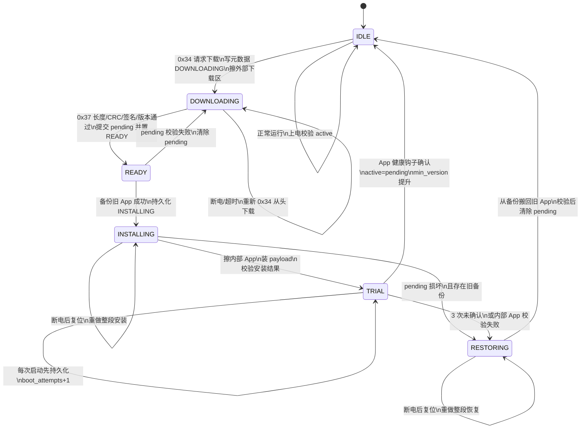
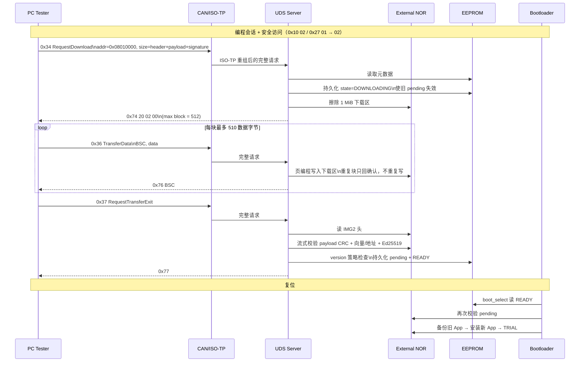

# 状态机、下载时序与五个脱稿讲点

这是给面试/白板讲解用的压缩材料。图按当前源码（v0.13 + UART 台架阶段）绘制；行号会变化，以函数名为准。

## 1. 升级状态机

关键代码入口：

- `boot_select()`：`src/core/boot.c`
- `boot_confirm()` / `boot_accept_app_health()`：`src/core/boot.c`
- `metadata_save()`：`src/core/metadata.c`（双副本、commit 最后写）
- `0x34/0x36/0x37`：`src/core/uds.c`

## 2. 0x34 → 0x36 → 0x37 时序

注意：

- `0x36` 阶段**只写不验**，半包不会被误判；验签集中在 `0x37`。
- 最大块长 512 包括 SID + BSC，所以数据最多 510 字节。
- UDS 的 BSC 是 8 位，从 1 开始，FF 后允许 00；ISO-TP 的 SN 是 4 位，从 1 开始，F 后回 0，两者不是同一个计数器。
- `0x37` 成功只代表包完整且通过校验，不代表 App 能运行；健康确认必须由运行中的 App 调用 `boot_confirm()`。

## 3. 五个脱稿讲点

### 讲点 1：为什么不用内部 A/B 双槽

- 内部 Flash 只有 1 MiB，App 需要 960 KiB。
- 真正双槽每槽最多约 480 KiB，装不下。
- 所以内部只放**一个固定地址 App**（`0x08010000`），新旧镜像放外部 NOR：下载区 1 MiB、备份区 1 MiB。
- 回滚只需把备份 payload 搬回固定地址，不改向量表偏移，也不维护两套链接地址。

### 讲点 2：为什么 `commit` 必须最后写

- EEPROM 记录 64 字节：magic、seq、state、active/pending 版本、CRC、commit。
- 更新时只写另一份副本：
  1. 先把目标副本 `commit` 清零并读回，确认旧记录失效；
  2. 写 body + CRC；
  3. **最后**写 `commit = 0xA55A5AA5`；
  4. 整条读回比对，成功后才承认保存。
- 如果先写 `commit`，掉电会留下“看起来有效、实际字段不全”的记录，事务语义直接崩掉。
- 两份副本任一份不可读就返回 I/O 错误，绝不猜测后用未知旧记录覆盖新记录。

### 讲点 3：备份区为什么可以免签名，边界在哪

- 备份内容来自“已经通过签名验证并安装的 App”，恢复时 MCU 没有私钥重签，所以只做 CRC。
- 例外必须钉死：`image_validate_backup()` 只接受 `BACKUP_OFFSET`，且 `flags == 0`，任何其他偏移在读字节前就拒绝。
- 如果放宽成“任意偏移 + CRC 通过即可”，攻击者就能拿它验下载区，等于绕过签名。这是真实修过的缺陷，不是风格问题。

### 讲点 4：Ed25519 为什么流式验证

- 镜像 1 MiB，RAM 只有 192 KiB，不能整包读入。
- 签名覆盖 32 字节 IMG2 头 + payload，64 字节签名追加在 payload 之后。
- 验证通过 `flash_port_t` 分块读 NOR，喂 `sha512_update`，内存占用恒定。
- 检查 `S < L`（RFC 8032），拒绝 `S+L` 这类非规范编码；所有入参在任何读之前校验。
- 边界：verify 使用 vartime 点运算可接受（只验公开数据、无私钥）；但这不是安全启动，没有 BootROM 信任根、没有 HSM、没有硬件防回滚计数器。

### 讲点 5：试运行计数为什么先持久化再启动

- TRIAL 每次启动前先 `boot_attempts++` 并 `metadata_save`，保存成功才允许跳 App。
- 如果先跳再记，中途掉电会忘记试过几次，可能无限重试，永远不回滚。
- 连续 3 次未确认（或内部 App 校验失败）进入 RESTORING，从备份区搬回旧版。
- 首次安装没有旧版时，失败后留在 Loader 并清除 pending，允许重新下载；不能声称恢复了不存在的旧版。

## 4. 白板顺序

1. 画三种存储：内部 Bootloader / 固定 App，外部下载区 / 备份区，EEPROM 双副本。
2. 画六状态机，重点停在三处：`commit` 末写、备份成功后擦 App、TRIAL 计数先落盘。
3. 画 0x34/0x36/0x37 时序，指出 0x36 只写、0x37 才验。
4. 讲失败路径：下载中断、备份中断、安装中断、试运行失败、恢复中断。
5. 最后主动说边界：主机模型 3164 断言、420 断电场景；实机尚未完成真实 CAN、真实擦写、真实断电。
